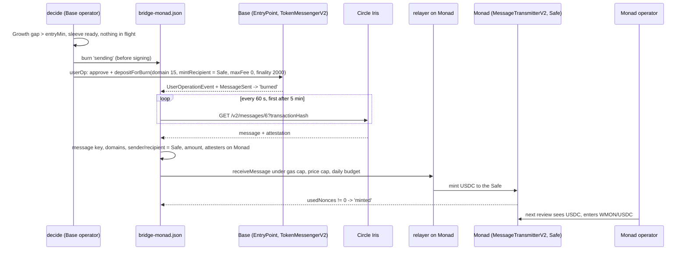
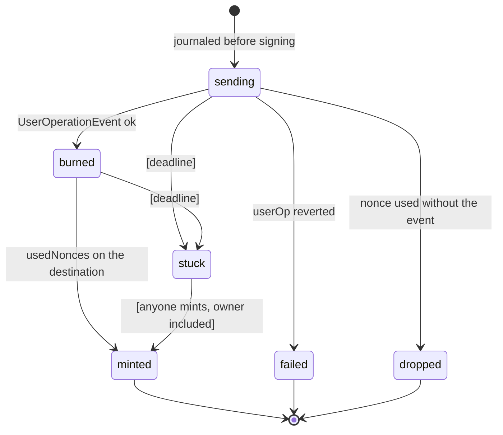
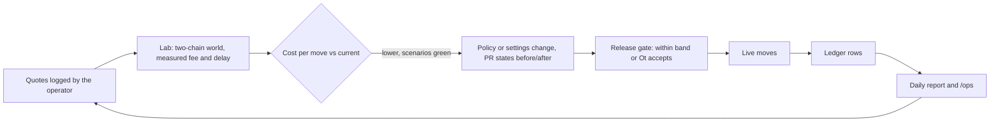

# 002 plan: multichain execution and moving funds between chains

- Spec: `specs/002-multichain-monad/spec.md`. Tasks: `tasks.md`. Scenarios: `scenarios.md`. Threats: `threats.md`.
- Date: 2026-10-29. Describes what runs on `main` and how the open requirements fit into it.

## 1. Summary

Two execution chains and one entry chain, one operator process per execution chain, one Safe address per account on every chain.
The Base operator owns the allocation: it values both chains, decides a `bridge_out` when Growth is short, burns USDC
with CCTP V2 under a session grant, and finishes the transfer on Monad from its relayer once Circle attests. The Monad
operator then enters WMON/USDC with the USDC that arrived, under the Monad sleeve's own policy. Ethereum has no
operator loop: the Base operator serves an owner-signed move to Base.

What is open is mostly around the bridge, not in it: the route is fixed instead of chosen, there is no cost ceiling,
readiness ignores revoked grants, a stuck move has no deadline, nothing records what a move cost, and the Lab cannot
simulate a second chain.

## 2. Constitution check

| Principle | How this plan obeys it |
|---|---|
| I. No custody | Every route's recipient is the account on the destination. Session routes pin it on-chain (FR-XCH-004); owner routes decode and check it (FR-XCH-005). No Mamoru contract or relayer holds funds in flight: CCTP burns and mints, Across is filled by third-party relayers to the account |
| III. Chains | Closed list in `packages/domain`, roles `execution` and `entry`, no default (FR-CHN-001, FR-CHN-002). Lab forks 31337 and 314143, never a supported id (FR-CHN-003) |
| IV. Uniswap V3 | Inside a chain, unchanged. Bridge contracts move capital only between chains |
| V. Gates | A bridge is an allocation step, below Purge and Risk Monitor; an exit on Base is never held by a bridge in flight |
| IX. Explicit session | The bridge grant names TokenMessengerV2, the selector, every argument and caps; `depositForBurnWithHook` has no action id. Paymaster only on the owner's entry userOp (#180) |
| X. Walkaway | The owner can mint a stuck CCTP message alone (`destinationCaller` 0) and withdraw on each chain with the passkey (FR-XCH-010) |
| XI. One operation, one nonce | One non-terminal operation per account and chain. A move is one operation on the source chain; the mint is the relayer's own transaction in its own nonce space on the destination |
| XVI. Truth on screen | In flight shown as in flight and counted once (FR-XCH-008, FR-XCH-017); an unobserved cost part is "not observed" (FR-COST-003) |
| XIX. Moving between chains | Existing routes only; session routes pinned; every move measured; new routes through the Lab (FR-XCH, FR-COST) |

## 3. Chains and registries (#60, #61, #62)

Built: `ChainDescriptor`, `SUPPORTED_CHAINS` (8453, 143), `registryFor`, `assertRegistryChain`, per-chain write opt-in,
`writeRegistry` in `apps/mamoru-operator/src/chain-writes.ts` that refuses a chain whose account stack differs from
Base.

Open, in this order:

1. **Ethereum descriptor and roles (#60).** `ChainId` gains 1 with `role: 'entry'`; Base and Monad get
   `role: 'execution'`. `FORBIDDEN_LAB_CHAIN_IDS` then includes 1 and 11155111 by derivation. `packages/routing` and
   `bridge-out.ts` read chain ids, USDC addresses and CCTP domains from `packages/domain` and the registries instead of
   their own constants.
2. **Registries complete (#60, #62).** `monad.json` pins TimeFramePolicy, UsageLimitPolicy and TokenMessengerV2;
   MessageTransmitterV2 enters both registries; an `ethereum.json` holds what the entry path calls (USDC, WETH,
   SpokePool, SwapRouter02, QuoterV2, TokenMessengerV2, the Chainlink feed). Every entry by an on-chain read at the
   registry's block; moving a registry's block re-reads every entry (the re-pin rule of the 2026-10-02 draft, kept).
3. **No default (#60).** `baseRegistry` appears in about 160 files. The default overload of `entry`, `address`,
   `nameOf` is already deprecated. Callers move in units of at most 12 files, package by package, Base output
   unchanged byte for byte (CHN-04). A count of implicit-registry call sites runs in `release:check` and may only go
   down; the default is removed in the last unit, when the count is zero.

## 4. Engine and D1 by chain (#64)

The engine Worker (`apps/mamoru-engine`) syncs Base only. It becomes one sync per chain in `SUPPORTED_CHAINS` with
`role: 'execution'`, each with `registryFor(chainId)`, the chain's policy and `RPC_URL_<chainId>`; a missing RPC logs
`CONFIG_CHAIN_RPC_MISSING` and skips that chain. `metrics_daily` gets `chain_id` in its key by an additive migration
(`XXXX_metrics_by_chain.sql`, number from the coordinator) that copies Base rows as 8453. MultiBaas per chain: MB-01
on a known Monad pool reconciled with `eth_call`, or `MULTIBAAS_ENGINE_ENABLED_143=false` and RPC logs for Monad.

## 5. The bridge leg as built (#213, #215)

State machine of one move, with what #245 adds in brackets:

Readiness today (`readSleeve`): the Safe has code on Monad and SmartSession is installed. In-flight: `sending` and
`burned` count; `minted` counts until the sleeve is read at or after `mintedBlock`. A failure starts a cooldown of 30
minutes doubling to 24 hours. The value of the sleeve is at the TWAP of each pool, never `slot0`.

## 6. Route choice in the engine (#133)

The Base → Monad leg stops being one fixed route. At proposal time the Base operator:

1. Builds a `QuoteRequest` (8453 → 143, USDC, amount, account) and runs `quoteAll` over the adapters whose route has a
   session grant installed on the account (CCTP V2 Standard today; CCTP V2 Fast and Across `depositV3` when their
   grants exist).
2. Keeps executable quotes in `session-key` mode only, and refuses any whose `target`, selector or pinned recipient
   does not match the grant (`ROUTE_NO_SAFE_QUOTE` when none is left).
3. Adds the gas of both chains (source userOp estimate, destination mint at the current price) to each quote's fee,
   priced in USDC at the chain's price pool (WETH/USDC on Base, WMON/USDC on Monad).
4. Applies the ceiling (§7), picks with `selectBest`, and journals the chosen quote and the runner-up with the move.

Adding Across as a session route is a policy change: a new grant (`depositor` = `recipient` = account, `outputToken` =
Monad USDC, `destinationChainId` 143, caps), a new policy version, the owner's re-signed approval, the Lab first
(§11). Relay, LI.FI and deBridge stay price oracles for the engine and owner-only routes for the app.

## 7. Cost ceiling, wait and batch (#188)

Engine settings (spec 006 templates), not code: `bridge.ceilingUsdc`, `bridge.ceilingBps`, `bridge.requoteMinutes`,
`bridge.maxWaitHours`. The ceiling is `min(ceilingUsdc, ceilingBps × amount)` over the total of §6 step 3.

- Under: propose `bridge_out`.
- Over: `DECIDE_WAIT_BRIDGE` detail `cost-above-ceiling`; the displaced amount enters locally only if the policy says
  so, otherwise stays idle on Base earning in Stable; quoted again after `requoteMinutes`.
- Batch: while waiting, later deposits and Base harvests grow the same Growth gap, so the next move carries all of
  them; `detail: 'batching'` when the gap is under the entry minimum but growing.
- After `maxWaitHours` without a quote under the ceiling: `DECIDE_BRIDGE_SKIPPED` detail `max-wait`, the allocation
  stays on Base, logged per account; the wait restarts at the next deposit.

Defaults come from a week of Base → Monad quotes logged by the operator (provider, amount, fee, ETA) before the GO.

## 8. Destination readiness (#243)

The Base operator does not know the Monad sleeve's permission ids. Two ways, the task picks one and says why:

- **Ask the Monad operator.** Its signed `/metrics` or a new signed endpoint reports per sleeve: permission ids enabled,
  `validUntil`, usage left. Cheap, but trusts the other operator's process.
- **Read the chain.** Derive the permission ids from the sleeve's policy and salts (deterministic in Smart Sessions)
  and read `isPermissionEnabled`, TimeFramePolicy and UsageLimitPolicy state on Monad at the read block. No trust in
  the other process; more reads.

Either way a sleeve whose grants are revoked, expired or used up reads `ready: false` with detail `session-inactive`,
and the app shows it on the Growth bucket.

## 9. A move that does not arrive (#245)

- Deadlines per state as engine settings: `bridge.deadline.sendingMinutes`, `bridge.deadline.burnedMinutes`
  (Standard: expected 15-20 min).
- Past the deadline: state `stuck` in the journal and the ledger, `BRIDGE_STUCK` in the operator's alert path
  (Mattermost, as the other operator alerts), the move in the app with the reason. The account's later bridges stay
  blocked: the money is still counted in flight, never twice.
- Recovery without Mamoru: Circle's attestation is public; `receiveMessage(message, attestation)` on Monad by any
  account mints to the Safe (`destinationCaller` 0). `docs/walkaway.md` gets the steps for each chain. The app can
  offer "finish the transfer" as an owner action from any wallet with MON.
- Across (once a session route): a deposit unfilled at `fillDeadline` is refunded to the account on Base in hours; the
  move says so and is counted in flight until the refund is seen.

## 10. Cost of every move (#129, #97, #246)

Ledger table, additive migration `XXXX_bridge_moves.sql`:

| Column | Meaning |
|---|---|
| `move_id` | userOp hash of the source operation |
| `account_key`, `source_chain_id`, `dest_chain_id` | who and where |
| `provider`, `route` | e.g. `cctp`, `CCTP V2 Standard` |
| `amount_in`, `amount_out` | USDC base units |
| `bridge_fee` | USDC; 0 for CCTP Standard |
| `source_gas_wei`, `source_gas_usdc` | account refund on the source chain, and its value at the block |
| `dest_gas_wei`, `dest_gas_usdc`, `dest_payer` | mint gas and who paid it (relayer or account) |
| `slippage` | swap legs only (entry conversion, withdraw), signed, USDC |
| `quote_json`, `runner_up_json` | the quote chosen and the next best |
| `proposed_at`, `signed_at`, `included_at`, `attested_at`, `arrived_at` | timestamps |
| `state` | `sending`, `burned`, `minted`, `failed`, `dropped`, `stuck` |
| `cost_usdc`, `cost_bps` | sum of the parts, null if a part is not observed (`MOVE_COST_NOT_OBSERVED`) |

Written by the Base operator through the same path as the yield receipts (`yield-receipts.ts`), as each state lands.
`/ops` reads it by env, chain, route and account per day (#97). The daily report (`mamoru-ops-report`) reads the same
source (#246). The move detail in the app reads the account's rows (#133).

## 11. Improvement loop (#246, #217)

- The Lab world (`packages/backtest/src/world.ts`) learns `bridge_out`: the move leaves the Base balance at the step,
  arrives after a delay drawn from the measured distribution of its route, and costs the measured fee and gas. Then
  the sweep can run v6 against v2 on the same windows (#217).
- A route candidate (CCTP Fast, Across) runs as a fork scenario: grant pinned, failure path, refund path; and its quotes
  are logged for the stated period. Only then it gets a grant in a live policy.
- The release gate prints cost per move from the Lab for the change and for `main`; over the band, the release waits
  for Ot.

## 12. Withdraw across chains (#202)

One request: a USD value, a destination chain and token. The operator of the chain with Stable plans first:

1. Take from Stable on the destination chain, then Stable on the other chain, then unwind positions by the policy's
   fixed priority, across both chains.
2. Each step is a candidate operation: unwind, swap, bridge (session route, toward the destination, recipient = the
   account), send (owner). The preview lists them and the amount that arrives, with the route's cost.
3. Bridge or swap steps run in order; the app shows a countdown from the routes' ETAs; the user's withdrawal to an
   outside address is the last step, signed by the owner, on the destination chain.
4. No float: Mamoru never pre-funds the destination.

A Monad → Base session route needs its own grant on the Monad sleeve (CCTP V2 domain 6, recipient the account). That is
a new grant, through the Lab.

## 13. One signature for both chains (#230)

Spike, no code before a verdict: does the deployed SmartSession on Base and Monad accept a multichain enable over
`ChainDigest[]`? Does a Safe ERC-7739 signature over a merkle root fit our `execTransaction` owner flow and the relayer
path? Until a verdict, two signatures, Monad first (a Base renewal to v6 refuses without an active sleeve). PR 166
(v7, #225) reduces prompts inside one chain and is not this.

## 14. Entry chain (#180, #211, #133)

Built and fork-proven; not active on production. Activation is Ot's and the coordinator's: a paymaster key, a little
ETH on the relayer on Ethereum, `MAMORU_L1_PAYMASTER_URL` on the operator, one operator redeploy, then the switch in
`/ops`. Today an entry move keeps its gas and fee in `BridgeOutRoute` only; once T034 lands it also writes a ledger row
like §10 (source 1, destination 8453).

## 15. Providers and failure

| Dependency | Fails how | What Mamoru does |
|---|---|---|
| Circle Iris (attestation) | Slow, down, wrong | Polls on; deadline then `BRIDGE_STUCK`; every attestation checked against the burn and the destination's attesters |
| CCTP contracts | Paused, upgraded (proxy) | Burn reverts → `failed`, cooldown. Today the addresses are constants and boot checks Monad's `localDomain()`; once T020 pins TokenMessengerV2 and MessageTransmitterV2 by code hash in both registries, a change stops the route at boot |
| Monad RPC | Down, lagging | Sleeve not ready, last value plus in flight; a lagging read is not used |
| Relayer on Monad | Out of MON, over budget | No mint; deadline then `BRIDGE_STUCK`; the owner can mint |
| Across | Unfilled | Refund after `fillDeadline` to the account; shown as hours |
| Quote APIs | Down, wrong | That adapter drops out of `quoteAll`; with none left the move waits (`ROUTE_NO_SAFE_QUOTE`) |
| Paymaster (entry) | Down | With account abstraction configured the move is refused with `BRIDGE_GAS_UNAVAILABLE` until it is back; the relayer path serves only when account abstraction is not configured |
