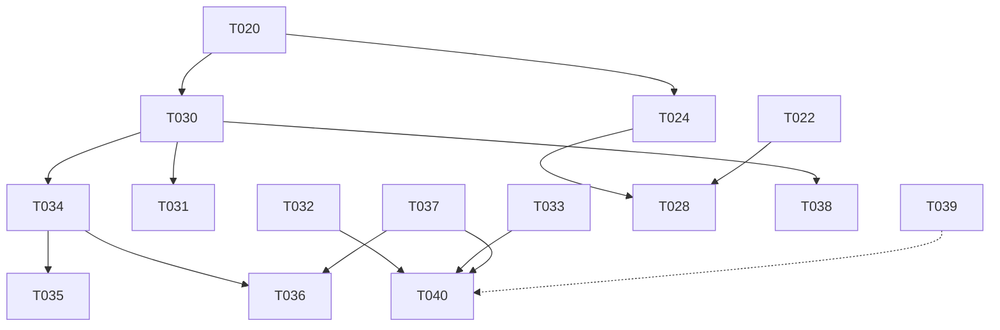

# 002 tasks: multichain execution and moving funds between chains

- Spec: `spec.md`. Plan: `plan.md`. Scenarios: `scenarios.md`. Threats: `threats.md`.
- Date: 2026-10-29.

These tasks are for later sessions; this pack stops before implementation. Each task is one unit of the flow in
`AGENTS.md`: a ticket in `doing`, its own worktree and branch from `origin/main`, at most about 12 files, `bun run
release:check` green, a pull request, an independent review, merge by the coordinator. A task that touches
`packages/policy`, `packages/account/sessions`, a grant or the bridge leg is funds code: it needs the high-stakes review
(GPT-6 Sol, or Opus and Argon both APTO).

## Done (no task)

| Draft id | Ticket | What | Commits |
|---|---|---|---|
| T021 | #61 | `ChainId`, descriptors, per-chain writes, gas on `gas_limit` chains | `62377b05`, `fa370b79` |
| T023 | #63 | Operator per chain, registry-aware write path | `fa370b79`, `7ab94071` |
| T025 | #65 | Monad fork harness, MONAD-01 | `f41bc05b` |
| T026 | #66 | Monad sleeve: WMON/USDC (decided in #201) | research note, #201 |
| T027 | #67 | Chain per sleeve in the web and D1, one dashboard | `cabd3077`, `51482f5e` |
| — | #213 | Policy v6 and the CCTP bridge-out grant | `0a9000c4`, `4b35f156`, `d003e250`, `537caa34` |
| — | #214 | Monad sleeve activation, v5-shaped sleeve policy | `84bb2cd3`, `0d422180`, `579b3f95` |
| — | #215 | Allocator `bridge_out`, bridge leg, journal and mint relay | `e46d8b8f`, `fed514d4`, `6c2e959d`, `587c26bf`, `13a39432` |
| — | #216 | Consent dialog, actual vs target | `19b74282`, `09f3866c`, `d81b11c3`, `9a8b6f9b` |
| — | #181 | Routing library | `packages/routing` |
| — | #133 (first use), #211 | Ethereum → Base move, ETH conversion | `c189fbc5` |

## Open tasks

| Task | Ticket | What |
|---|---|---|
| T020 | #60 | Chain list with roles, complete registries, no implicit Base default |
| T022 | #62 | Session policies on Monad pinned, with evidence and the replay test |
| T024 | #64 | Engine sync and metrics per chain, MultiBaas per chain |
| T028 | #68 | Monad operator live under the cap |
| T030 | #133 | Route choice in the engine's bridge leg; Across as a second session route |
| T031 | #188 | Cost ceiling, wait and batch |
| T032 | #243 | Destination readiness reads the grants |
| T033 | #245 | Stuck move: deadline, alert, reason, owner recovery |
| T034 | #129 | One ledger row per move |
| T035 | #97 | Cost per move in `/ops` |
| T036 | #246 | Cost per move in the daily report and the release and Lab gates |
| T037 | #217 | Two-chain Lab and the v6 vs v2 run |
| T038 | #202 | Withdraw across chains |
| T039 | #230 | One signature for both chains (spike) |
| T040 | #240, #231 | Monad sleeve on production, both Safes at onboarding |
| T041 | #244 | Lab: Ethereum pools vs routing to Base |

Order: T032, T033 and T034 first (they make the live leg safe and measured), then T030, T031, T037, T036, T035, T040,
T038. T020, T022 and T024 run in parallel in their own units. T039 and T041 are research and do not block.

## Rules for every task

1. **Base does not change.** Base scenarios stay green; where the task says so, Base output byte for byte (CHN-04).
2. **No default chain.** No new default argument, chain constant or branch on a chain name outside `packages/domain`
   and the registries.
3. **No own bridge.** No contract, relayer or liquidity of Mamoru's own between chains (principle XIX).
4. **Recipient is the account.** A session route without an on-chain pinned recipient is never granted.
5. **No deploy, no flag flip, no grant change on live accounts.** Those are the coordinator's and Ot's.
6. **Never** sign or send against 1, 8453 or 143 from a task; never start anvil with a forbidden chain id; never put an
   address in a registry without its on-chain read.

## T020 · Chains with roles, complete registries, no implicit Base default

- **Ticket:** #60. **Requirements:** FR-CHN-001, FR-CHN-002, FR-CHN-003, FR-CHN-004.
- **Units** (each ≤ 12 files):
  1. Ethereum descriptor and `role` in `packages/domain/src/chains.ts`; `FORBIDDEN_LAB_CHAIN_IDS` gains 1 and
     11155111 by derivation; `packages/routing/src/chains.ts` reads from domain.
  2. `monad.json` pins TimeFramePolicy, UsageLimitPolicy, TokenMessengerV2; MessageTransmitterV2 in both registries;
     `ethereum.json` for the entry path, each by an on-chain read at the registry's block.
  3. A count of implicit-registry call sites in `release:check` (may only go down).
  4. to n. Callers move package by package; the last unit removes the default overload.
- **Accepted by:** CHN-01, CHN-04, CHN-05, CHN-06.
- **Must not:** change a Base address, calldata or output; drop a registry entry the live path reads; move a registry
  block without re-reading every entry.

## T022 · Session policies on Monad pinned, with evidence and the replay test

- **Ticket:** #62. **Requirements:** FR-ACC-012, FR-ACC-013, FR-ACC-015.
- **Files:** `packages/registry/monad.json`, `evidence/monad/` (deployment transactions and code hashes, no keys),
  `packages/scenarios/monad/` (expiry and usage-limit scenario, SESS-27).
- **Accepted by:** MON-04, SESS-26, SESS-27.
- **Must not:** inject code into the fork for a test to pass; write Solidity; accept a policy whose code hash differs
  from Base.

## T024 · Engine sync and metrics per chain, MultiBaas per chain

- **Ticket:** #64. **Requirements:** FR-CHN-009, FR-CHN-010.
- **Files:** `apps/mamoru-engine/src/index.ts`, `apps/mamoru-engine/src/sync/run.ts`, `apps/mamoru-engine/wrangler.jsonc`
  (vars only), `migrations/d1/XXXX_metrics_by_chain.sql`, projector and API types that carry `chain_id`.
- **Accepted by:** ENG-01, ENG-02, ENG-03, MB-05.
- **Must not:** deploy the Worker; apply the migration; lose or rewrite a Base row.

## T028 · Monad operator live under the cap

- **Ticket:** #68. **Requirements:** FR-CHN-005, FR-CHN-006, FR-CHN-007.
- **Files:** the runbook entry and unit name only; the operator code is built.
- **Accepted by:** READY-01 with writes off, then LIVE-01 after Ot's action.
- **Must not:** set `MAMORU_CHAIN_WRITES=143` on a running operator, fund the relayer, or redeploy: Ot and the
  coordinator do.

## T030 · Route choice in the engine's bridge leg; Across as a second session route

- **Ticket:** #133 (R3, R4). **Requirements:** FR-XCH-003, FR-XCH-004, FR-XCH-005, FR-XCH-017.
- **Units:**
  1. The Base operator quotes the session routes the account has grants for, adds gas on both chains, journals the
     chosen quote and the runner-up (`apps/mamoru-operator/src/bridge-monad.ts`, a small quote module, tests). With one
     grant (CCTP Standard) the outcome is today's, plus the record.
  2. The move detail in the app shows route, cost and time.
  3. Across `depositV3` grant toward Monad in a new policy version (`packages/policy`), with its fork scenario. Behind
     the Lab (T037) and Ot's GO; never on live accounts from the task.
- **Accepted by:** XCH-03, XCH-04, XCH-08.
- **Must not:** let a session key send aggregator calldata; grant `depositForBurnWithHook`; change the live policy.

## T031 · Cost ceiling, wait and batch

- **Ticket:** #188. **Requirements:** FR-XCH-006, FR-XCH-017.
- **Files:** `packages/decide/src/allocate/index.ts`, engine settings template (spec 006), operator quote log, app
  waiting copy, tests.
- **Accepted by:** XCH-05.
- **Must not:** hard-code the ceiling; show amounts in the waiting state; drop an allocation without a reason code.
  Defaults wait for a week of logged quotes and Ot's GO (NEEDS CLARIFICATION 2).

## T032 · Destination readiness reads the grants

- **Ticket:** #243. **Requirements:** FR-XCH-007.
- **Files:** `apps/mamoru-operator/src/bridge-monad.ts` (`readSleeve`), the readiness source chosen in plan §8, the
  app's Growth bucket state, tests.
- **Accepted by:** XCH-06.
- **Must not:** treat an unreadable grant as ready; let readiness fail open when the Monad RPC is down.

## T033 · Stuck move: deadline, alert, reason, owner recovery

- **Ticket:** #245. **Requirements:** FR-XCH-010, FR-XCH-017.
- **Files:** `apps/mamoru-operator/src/bridge-monad.ts`, operator alert path, engine settings template,
  `docs/walkaway.md`, app move state, tests and a fork scenario.
- **Accepted by:** XCH-07.
- **Must not:** count a stuck move twice or zero; unblock the account's next bridge while the first is unresolved;
  mint from the relayer above its caps to clear a backlog.

## T034 · One ledger row per move

- **Ticket:** #129. **Requirements:** FR-COST-001, FR-COST-002, FR-COST-003, FR-AA-007.
- **Files:** `migrations/d1/XXXX_bridge_moves.sql`, `apps/mamoru-operator/src/yield-receipts.ts` (or a sibling
  writer), the Worker route that stores it, types, tests.
- **Accepted by:** COST-01.
- **Must not:** write zero for a part that was not observed; mix the account's gas with the relayer's.

## T035 · Cost per move in `/ops`

- **Ticket:** #97. **Requirements:** FR-COST-004.
- **Files:** the `/ops` read model and view (landing repo if the view lives there, said in the PR).
- **Accepted by:** COST-02 a.
- **Must not:** compute cost anywhere but from the ledger rows.

## T036 · Cost per move in the daily report and the release and Lab gates

- **Ticket:** #246. **Requirements:** FR-COST-005, FR-COST-006, FR-COST-007.
- **Files:** `mamoru-ops-report` (report block), the Lab sweep's output, the release check's gate line.
- **Accepted by:** COST-02 b, COST-03, COST-04.
- **Must not:** block a release on a band Ot has not set (NEEDS CLARIFICATION 3); report "0" on a day with no moves.

## T037 · Two-chain Lab and the v6 vs v2 run

- **Ticket:** #217. **Requirements:** FR-COST-008.
- **Files:** `packages/backtest/src/world.ts`, `run.ts` (bridge gas), a route cost and delay model fed by logged
  quotes, the sweep.
- **Accepted by:** COST-05; the #217 beta test with test accounts.
- **Must not:** invent a route cost: a route without measured quotes is not modelled.

## T038 · Withdraw across chains

- **Ticket:** #202. **Requirements:** FR-XCH-012.
- **Units:** decision tree in `packages/decide`; the Monad → Base bridge grant on the sleeve (new policy version, Lab
  first); the preview and countdown in the app.
- **Accepted by:** XCH-09.
- **Must not:** pre-fund the destination; let the user pick positions; send to an outside address with a session key.

## T039 · One signature for both chains (spike)

- **Ticket:** #230. **Requirements:** FR-ACC-017.
- **Files:** a research note under `specs/007-onchain-action-policy/results/` or `docs/`, and a fork probe.
- **Accepted by:** a written verdict checked against the deployed SmartSession on Base and Monad; if yes, SIG-01.
- **Must not:** change the owner flow before the verdict; propose upgradeable policies or Permit2.

## T040 · Monad sleeve on production, both Safes at onboarding

- **Tickets:** #240, #231. **Requirements:** FR-ACC-016.
- **Files:** `apps/mamoru-app/src/api/sleeves.ts`, `ops-flags.ts`, onboarding route, tests.
- **Accepted by:** XCH-10.
- **Must not:** drop the Safe derivation check; turn on `multichain_v6` for anyone.

## T041 · Lab: Ethereum pools vs routing to Base

- **Ticket:** #244. **Requirements:** FR-COST-009, FR-CHN-011.
- **Files:** a Lab run and its result note.
- **Accepted by:** COST-06.
- **Must not:** add an Ethereum strategy or grant.

## Not tasks: actions of Ot and the coordinator

- #180: paymaster key, relayer ETH on Ethereum, `MAMORU_L1_PAYMASTER_URL`, operator redeploy, the `/ops` switch.
- #68: relayer MON, `MAMORU_CHAIN_WRITES=143` on the Monad operator, its unit.
- Turning `multichain_v6` on per account after #217.
- The GO on the cost ceiling defaults (#188) and the release gate band (#246).
